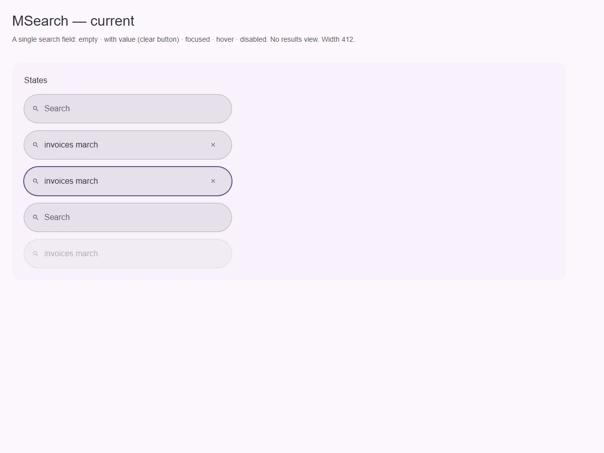
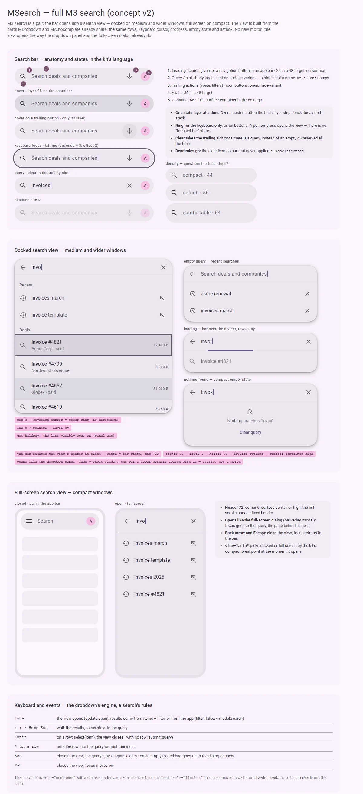

# MSearch — поисковая строка и вид результатов

<identity>M3: Search (search bar; search view — docked и full-screen; Expressive: search app bar) · Токены Compose: `SearchBarTokens`, `SearchViewTokens` + `SearchBar.kt` · Код: `src/runtime/components/ui/search/` · Аудит: `data/search.json` · Тип: public</identity>

<implementation-status state="partial" updated="2026-10-19">Строка сделана в M3-polish (2026-10-19): `id` потребителя на input, Escape очищает и испускает `clear`, Enter во время IME не отправляет, `:autofill`, кольцо в forced colors. Решение владельца 2026-10-19: MSearch становится полным M3-поиском — строка плюс вид результатов на движке MDropdown. План переписан под это (v2), концепт-рендер обновлён. Реализация не начата.</implementation-status>

## Вердикт

`переработка`. Сейчас MSearch — половина M3-поиска, и в ките он стоит особняком.

Почему он не органичен:
1. **Нет вида результатов.** В M3 поиск — это пара: строка раскрывается в вид. У кита есть только строка;
   Enter испускает `submit`, подсказки каждое приложение собирает само.
2. **Два поиска на разных языках.** Подсказки по вводу умеет `MAutocomplete`, но выглядит как поле формы.
   `MSearch` выглядит как M3-строка, но ничего не подсказывает. Общего движка у них нет.
3. **Фокус не как у соседей.** Кольцо загорается на любой фокус, включая клик мышью (`isFocused` из
   focus/blur). У кнопок кольцо только с клавиатуры. В M3 нажатие на строку открывает вид, состояния
   «сфокусированная строка» нет.
4. **Слои складываются.** Над кнопкой очистки — слой строки и слой `MButtonIcon` сразу. Правило цвета
   иконки очистки мёртвое: проигрывает правилу кнопки в любой сборке (аудит порядка CSS 2026-10-19).
5. **Мимо осей кита.** Нет density (всегда 56), нет загрузки. Очистка всегда держит 48 места, даже скрытая.
   API `v-model:focused` не встречается больше нигде в ките.

Цель: строка и вид собраны из частей, которые уже есть у MDropdown и MAutocomplete: строки панели,
клавиатурный курсор, прогресс, пустое состояние, listbox. Новой механики оверлеев и нового морфа нет.

## Рендеры

| Сейчас | Концепт v2 |
|---|---|
|  |  |

Концепт v2:
1. Строка: анатомия, состояния на языке кита, density (вопрос 1).
2. Docked-вид: шапка вместо строки, группы, клавиатурный курсор, загрузка, пусто, недавние.
3. Полноэкранный вид на compact и строка в app bar до открытия.
4. Клавиатура и события.

## Анатомия

**Строка**

| # | Часть M3 | В ките сейчас | Цель |
|---|---|---|---|
| 1 | Leading: поиск или навигация, 24 в 48, `on-surface` | слот `#leading` | без изменений |
| 2 | Запрос / подсказка, body-large | `input type="search"` | без изменений; подсказка — не имя, `aria-label` обязателен |
| 3 | Trailing-кнопки, `on-surface-variant` | слот `#trailing` + очистка, вечно держащая 48 | очистка занимает trailing-слот, когда есть запрос |
| 4 | Аватар 30 в цели 48 | слот `#avatar` | без изменений |
| 5 | Контейнер 56, full, `surface-container-high`, без рамки | есть | + density по вопросу 1 |

**Docked-вид** (средние и широкие окна)

| # | Часть | Значение |
|---|---|---|
| 1 | Поверхность | `surface-container-high`, угол extra-large 28, level 3; ширина = ширина строки, максимум 720 |
| 2 | Шапка 56 | сама строка: leading меняется на «назад», запрос, очистка |
| 3 | Разделитель | 1, `outline`; при загрузке поверх него лежит линейный прогресс |
| 4 | Результаты | строки общей панели dropdown, высота панели обрезана на середине строки |
| 5 | Группы | подзаголовок + строки (вопрос 4) |

**Полноэкранный вид** (compact): шапка 72, угол 0, тот же контейнер; список прокручивается под
неподвижной шапкой.

## Оси дизайна

| Ось | M3 | Цель | Ломает API |
|---|---|---|---|
| Вид результатов | нет · docked · full-screen | `view: 'none' \| 'docked' \| 'fullscreen' \| 'auto'` (дефолт — вопрос 2) | нет |
| Порог полноэкранного вида | compact < 600 | вопрос 3 | нет |
| Место | отдельно · в app bar | рецепт в app bar ([app-bar](../navigation/app-bar.md)) | нет |
| `density` | нет | вопрос 1 | нет |

## Оси состояний

| Ось | Цель |
|---|---|
| Взаимодействие | слой hover 8% на контейнере; над вложенной кнопкой слой строки уступает (`:has()`); нажатие — рипл кнопки |
| Фокус | кольцо кита только с клавиатуры (`:focus-visible`), как у кнопок; нажатие указателем открывает вид |
| Раскрытие | закрыта · открыта (docked / full-screen) |
| Данные в виде | результаты · недавние при пустом запросе · загрузка · ничего не найдено · ошибка (рецептом, как у MAutocomplete) |
| disabled | 38%, вид не открывается |

## Токены

| Часть | Значение | Откуда |
|---|---|---|
| Строка | как сейчас (`search/_index.scss`) | — |
| `view.docked` | shape extra-large, elevation level 3, header 56, divider `outline` | `SearchViewTokens` |
| `view.full` | shape none, header 72 | `SearchViewTokens` |
| Строки результатов, курсор, прогресс, пусто | токены `dropdown` / `list` | общая панель |

Новых системных токенов нет. Плотность (если будет) — через `density-step()` полей.

## Поведение и доступность

**Роли.** Поле запроса — `role="combobox"`, `aria-expanded`, `aria-controls` на результаты `role="listbox"`,
`aria-autocomplete="list"`. Курсор двигается через `aria-activedescendant`, фокус не покидает поле.
Число результатов и загрузка объявляются через `usePanelStatus`, как у MDropdown.

**Клавиатура**

| Клавиша | Действие |
|---|---|
| ввод | вид открывается (`update:open`) |
| ↓ ↑ · Home End | движение по результатам |
| Enter | на строке — `select(item)` и закрытие (вопрос 5); без строки — `submit(query)` |
| ↖ на строке | строка переходит в запрос без запуска |
| Esc | закрывает вид, запрос остаётся → ещё раз: очищает → на пустой закрытой строке уходит дальше (диалог, лист) |
| Tab | закрывает вид, фокус идёт дальше |

**Фокус.** Docked: фокус всё время в поле строки. Полноэкранный вид — модальный `MOverlay`: ловушка
переводит фокус на поверхность, компонент сразу ставит его в поле запроса. При закрытии фокус
возвращается в строку.

**Движок.** `useDropdownControl` в режиме без выбранного значения: модель — запрос, выбор — событие.
Панель — общий фрагмент `fragments/dropdown/Panel.vue`. Docked-вид открывает `MMenu` так же, как MDropdown
(`absolute`, `match-width`, anchor = строка). Полноэкранный — `MOverlay`. Новый контроллер оверлея не заводится.

**Движение.** Docked-вид открывается переходом панели dropdown. Полноэкранный — переходом полноэкранного
диалога. Нижние углы строки меняются вместе с появлением панели, без анимации формы: новый морф — стоп-правило.
При `prefers-reduced-motion` переходы мгновенные, как у тех же компонентов.

**Порядок CSS в prod.** Переопределения корней `MMenu`, `MOverlay`, `MButtonIcon` пишутся составным
селектором блока `ui-search`. Проверять e2e на prod-сборке.

## API

| Что | Изменение | Ломает |
|---|---|---|
| `view` | новый: `'none' \| 'docked' \| 'fullscreen' \| 'auto'` | нет |
| `items`, `itemTitle`, `itemValue` | новые, как у MDropdown | нет |
| `filter` | новый: по заголовку (дефолт) · функция · `false` (фильтрует приложение) | нет |
| `loading` | новый: прогресс поверх разделителя | нет |
| `messages` | новый, без дефолтов: `noResults`, `loading`, `back`, `clear` | `clearLabel` → `messages.clear` |
| `v-model` | запрос, как сейчас | нет |
| `v-model:open` | новый | нет |
| `v-model:focused` | удалить без шима (правило «no legacy shims pre-stable») | да |
| слоты | есть `#leading`, `#trailing`, `#avatar`; новые `#item` (как у MDropdown), `#no-results`, `#loading` | нет |
| события | `submit(query)`, `clear`; новый `select(item)` | нет |

## План работ

1. **S — строка на языке кита.**
   - Один слой: слой корня уступает над вложенной кнопкой.
   - Кольцо только `:focus-visible`.
   - Очистка занимает trailing-слот вместо вечного резерва 48.
   - Удалить `v-model:focused` и мёртвое правило цвета очистки.
2. **M — общая панель.** Группы с подзаголовком (`role="group"` + `aria-labelledby`), trailing-действие строки
   (↖ вставить, × удалить из недавних). Файлы: `fragments/dropdown/Panel.vue`, `utils/dropdown/useDropdownEntries.ts`.
   MDropdown и MAutocomplete получают группы бесплатно (вопрос 4).
3. **L — docked-вид.**
   - `MMenu` от строки, строка становится шапкой.
   - `useDropdownControl` без выбранного значения.
   - combobox/listbox, загрузка, «ничего не найдено», недавние при пустом запросе.
4. **M — полноэкранный вид.** `MOverlay` modal, шапка 72, фокус в поле, возврат фокуса; `view="auto"` по порогу
   (вопрос 3).
5. **S — рецепт в app bar и демо.** CRM и Orders получают настоящие результаты. Вайрфреймы docs_v2 используют только
   строку и не меняются.
6. **M — тесты и документация.** Changelog в docs_v2.

## Тесты

- Unit:
  - строка: один слой над кнопкой, очистка в trailing-слоте, Esc-каскад, `submit` по Enter, IME;
  - вид: `aria-expanded`, `aria-activedescendant` двигается стрелками, Enter → `select`, Esc закрывает и
    оставляет фокус, Tab закрывает;
  - группы: `role="group"` с именем.
- e2e (на prod-сборке):
  - `view="auto"`: на 360 полноэкранный вид, на 1366 docked;
  - открытие не сдвигает страницу; docked-вид совпадает по ширине со строкой;
  - фокус возвращается в строку после закрытия полноэкранного вида;
  - axe в открытом виде, светлая и тёмная тема, RTL;
  - результаты не выходят за окно.

## Готово, когда

- Строка ведёт себя как соседи: один слой, кольцо только с клавиатуры, без пустого резерва.
- Вид результатов есть в двух формах, на движке и панели MDropdown, с доступной клавиатурой.
- Нет зашитых английских строк.
- e2e на prod-сборке зелёные.

## Предложения по UX

Расширения сверх паритета с M3 — предложения владельцу, не шаги плана.

| Предложение | Что получает пользователь | Цена | Рекомендация |
|---|---|---|---|
| Горячая клавиша `/` или `mod+k` фокусирует строку (`useHotkey`) | Быстрый поиск с клавиатуры | S · реестр уже есть | да |
| Подсветка совпадения в строках (жирным, без `v-html`) | Видно, почему результат подошёл | S · общая утилита для MAutocomplete тоже | да |
| Рецепт серверного поиска: `filter: false` + `refDebounced` + `AbortSignal` | Список не мигает, сеть не перегружается | S · только документация | да |

## Открытые вопросы

Отвечать по одному.

**1. Плотность строки.**
1. Только 56, как в M3. Цена: в плотной шапке рядом с compact-полями (44) строка выглядит крупной.
2. Ступени полей: compact 44 · default 56 · comfortable 64. Цена: отход от M3, ещё одна ось в токенах.
   **(рекомендую)** — поиск стоит рядом с полями и кнопками, у которых density есть.

**2. Когда показывать вид.**
1. `view` по умолчанию `'none'`: вид включает приложение. Цена: вид надо не забыть включить.
2. По умолчанию `'auto'`, но вид открывается, только когда ему есть что показать: переданы `items` или
   слот `#item`. **(рекомендую)** — так же устроено решение о строке поддержки полей.

**3. Порог полноэкранного вида.**
1. Свой проп `fullscreenBelow` в rem, дефолт 600. Цена: ещё одна настройка на экземпляре.
2. Брейкпоинт из конфига кита (`less['tablet-xs']`). Цена: имена брейкпоинтов задаёт приложение,
   и ключа может не быть.
3. Оба: проп с дефолтом 600 **(рекомендую)** — работает без конфига, переопределяется на месте.

**4. Группы в общей панели.**
1. Только в MSearch. Цена: две реализации строк.
2. В общей панели — MDropdown и MAutocomplete получают группы тоже (M3 menus делят пункты на группы).
   **(рекомендую)**

**5. Что выбор строки делает с запросом.**
1. Запрос становится заголовком строки, вид закрывается. **(рекомендую)** — как в поисковиках, видно,
   что выбрано.
2. Запрос не меняется. Цена: после выбора строка поиска показывает недописанный ввод.

**6. Недавние запросы.**
1. Их хранит приложение и передаёт как группу в `items`; кит только рисует × и испускает `remove(item)`.
   **(рекомендую)** — кит не владеет хранилищем.
2. Кит хранит сам (проп-адаптер, `sessionStorage` по умолчанию). Цена: хранилище в ките и политика очистки.

## Заметки реализации

- Строка (M3-polish 2026-10-19): фокус — кольцо кита на корне; дефолт `placeholder` снят; «Clear search» →
  `clearLabel`; очистка — `MButtonIcon`, всегда в разметке, скрыта `visibility`. Шаг 1 плана v2 меняет
  последнее: очистка занимает trailing-слот.
- Аудит порядка CSS 2026-10-19: `.ui-search__clear { color }` проигрывает `.ui-button--current.ui-button--text`
  в любой сборке — правило мёртвое (`.cursor/summary/prod-override-child-root_2026-10-19_1520.md`).
