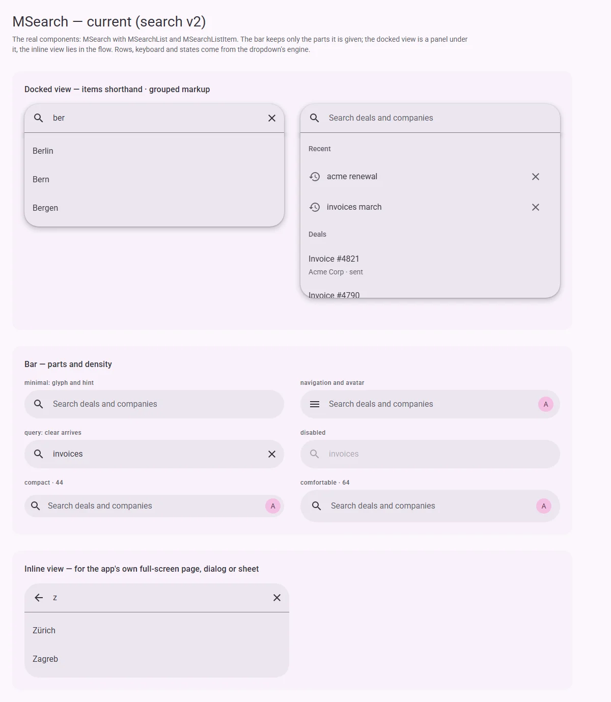
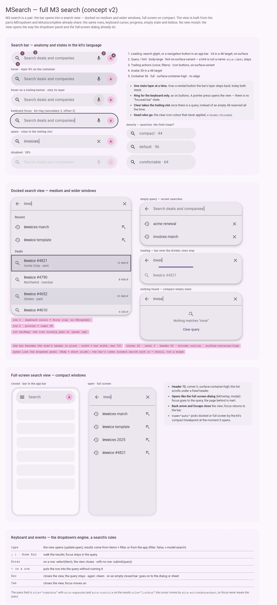

# MSearch — поисковая строка и вид результатов

<identity>M3: Search (search bar; search view — docked и full-screen; Expressive: search app bar) · Токены Compose: `SearchBarTokens`, `SearchViewTokens` + `SearchBar.kt` · Код: `src/runtime/components/ui/search/` · Аудит: `data/search.json` · Тип: public</identity>

<implementation-status state="done" updated="2026-10-20">План v2.1 реализован 2026-10-20: строка на языке кита (density 44/56/64, один слой, кольцо только с клавиатуры, очистка без резерва, отступ у края по последней части), вид `docked` (MMenu от строки) и `inline`, публичные `MSearchList` / `MSearchListItem`, сокращение `items` с общим фильтром (`utils/dropdown/matchRows.ts`), движок MDropdown через `utils/search/useSearchControl.ts`. Открытые вопросы закрыты рекомендованными вариантами по слову владельца «давай сделаем поиск уже». Рендер концепта v2 ещё рисует полноэкранный вид — не обновлён.</implementation-status>

## Вердикт

`переработка`. Сейчас MSearch — половина M3-поиска, и в ките он стоит особняком.

Почему он не органичен:
1. **Нет вида результатов.** В M3 поиск — это пара: строка раскрывается в вид. У кита есть только строка;
   Enter испускает `submit`, подсказки каждое приложение собирает само.
2. **Два поиска на разных языках.** Подсказки по вводу умеет `MAutocomplete`, но выглядит как поле формы.
   `MSearch` выглядит как M3-строка, но ничего не подсказывает. Общего движка у них нет.
3. **Фокус не как у соседей.** Кольцо загорается на любой фокус, включая клик мышью (`isFocused` из
   focus/blur). У кнопок кольцо только с клавиатуры.
4. **Слои складываются.** Над кнопкой очистки — слой строки и слой `MButtonIcon` сразу. Правило цвета
   иконки очистки мёртвое: проигрывает правилу кнопки в любой сборке (аудит порядка CSS 2026-10-19).
5. **Мимо осей кита.** Нет density (всегда 56), нет загрузки. Очистка всегда держит 48 места, даже скрытая.
   API `v-model:focused` не встречается больше нигде в ките.

Цель: строка и вид собраны из частей, которые уже есть у MDropdown и MAutocomplete: движок listbox,
клавиатурный курсор, строки `MListItem`, прогресс, пустое состояние. Новой механики оверлеев и нового морфа нет.

## Решения владельца (2026-10-19)

| Вопрос | Решение |
|---|---|
| Куда развернуть MSearch | полный M3-поиск: строка + вид результатов |
| Docked-вид | строка остаётся на месте и становится шапкой; под ней панель `MMenu` с `match-width`. Одно поле ввода |
| Чем наполнять вид | публичные `MSearchList` (группа) и `MSearchListItem` (строка) — приложение собирает результаты из компонентов |
| Проп `items` | остаётся сокращением: MSearch сам рисует те же `MSearchList` / `MSearchListItem` |
| Полноэкранный вид | кит его не открывает: это решение приложения. Кит даёт `view="inline"` — результаты в потоке под строкой; полноэкранный поиск — рецепт (inline-поиск в странице, диалоге или листе приложения) |
| Аватар и навигация | необязательные части: строка собирается из того, что передали, отступ у края — по последней части |

## Рендеры

| Сейчас (v2, настоящие компоненты) | Концепт v2 |
|---|---|
|  |  |

«Сейчас» снят с `playground/render/gallery/search.vue` на prod-сборке 2026-10-20: строка в разных составах и ступенях,
docked-вид из `items` и из разметки с группами, inline-вид. Концепт v2 ещё рисует полноэкранный вид от кита — снят
решением владельца, вместо него inline-вид в странице приложения.

## Анатомия

**Строка**

| # | Часть | Обязательна | Цель |
|---|---|---|---|
| 1 | Leading, 24 в цели 48, `on-surface` | да | по умолчанию декоративная иконка поиска; кнопка навигации — через `#leading`, только где нужна |
| 2 | Запрос / подсказка, body-large | да | подсказка — не имя, `aria-label` обязателен |
| 3 | Очистка, 48 | при запросе | появляется с первым символом — когда исчезает подсказка, поэтому видимо ничего не сдвигается; вечного резерва нет |
| 4 | Trailing-кнопки, `on-surface-variant` | нет | слот `#trailing` |
| 5 | Аватар 30 в цели 48 | нет | слот `#avatar` |
| 6 | Контейнер 56, full, `surface-container-high`, без рамки | да | отступ у края 4, если последняя часть — цель 48, иначе 16. Модификатор считается из слотов и запроса — верный с первого кадра SSR |

**Docked-вид**

| # | Часть | Значение |
|---|---|---|
| 1 | Шапка | сама строка: нижние углы 0, пока вид открыт |
| 2 | Панель | `MMenu` (`absolute`, `match-width`, anchor = строка): `surface-container-high`, нижние углы extra-large 28, level 3; тень сверху обрезана по шву |
| 3 | Разделитель | 1, `outline`; при загрузке поверх него лежит линейный прогресс |
| 4 | Результаты | `MSearchList` / `MSearchListItem`; высота панели обрезана на середине строки, как у MDropdown |

**Inline-вид:** строка, разделитель и результаты в потоке, без popover и тени. Размер и место задаёт
приложение — так собирается полноэкранный поиск на compact.

## Публичные компоненты

```vue
<MSearch v-model="query" :messages="searchMessages" @select="open" @submit="runSearch">
  <MSearchList title="Недавние">
    <MSearchListItem v-for="q in recent" :key="q" :value="q" :headline="q">
      <template #leading><MIcon :name="ICONS.history" /></template>
    </MSearchListItem>
  </MSearchList>

  <MSearchList title="Сделки">
    <MSearchListItem v-for="deal in deals" :key="deal.id" :value="deal" :headline="deal.title" :supporting-text="deal.client" />
  </MSearchList>
</MSearch>
```

- **`MSearch`** — строка, поле `role="combobox"`, корень `role="listbox"`, состояния вида. Слот по умолчанию
  рисуется в docked-панели или в inline-виде.
- **`MSearchList`** — группа: `role="group"` с подзаголовком из `title` / `#title`; без заголовка — контейнер.
- **`MSearchListItem`** — на `MListItem` (`headline`, `supporting-text`, слоты), поэтому строки выглядят как
  строки MDropdown. Регистрируется в контексте поиска, получает `role="option"`, id и атрибуты движка.
  Клик или Enter испускают `select(value)` у `MSearch`.
- **`items`** (+ `itemTitle`, `itemValue`, `filter`, слот `#item`) — сокращение: MSearch рисует те же
  компоненты сам.

## Технический дизайн

| Файл | Что делает |
|---|---|
| `components/ui/search/index.vue` | строка + хост вида: `MMenu` для docked, поток для inline; провайдит контекст |
| `components/ui/search/list/index.vue` | `MSearchList` |
| `components/ui/search/list/item/index.vue` | `MSearchListItem` |
| `utils/search/useSearchControl.ts` | обёртка над `useDropdownControl` |
| `utils/search/context.ts` | контекст поиска: регистрация строк, атрибуты, выбор |

`useSearchControl`:
- модель выбора внутренняя и всегда пустая; модель компонента — сам запрос, при blur не откатывается
  (в отличие от `useAutocomplete`, который возвращает в поле заголовок выбранного);
- выбор строки — событие `select`;
- Esc каскадом: закрыть вид → очистить запрос → отпустить клавишу;
- IME: Enter во время композиции не читается.

**Движок.** Зарегистрированные строки идут в `useDropdownControl` как `items`. Стрелки, Home/End, Enter и
`aria-activedescendant` работают как у MDropdown. Реестр кита (`createRegistry`) хранит порядок регистрации,
а не DOM; после фильтрации `v-for` они расходятся, поэтому строки сортируются по положению в DOM.

**Фокус.** У текстового поля `:focus-visible` срабатывает и на клик мышью, поэтому указатель отличается по
`pointerdown`, как в MAutocomplete: фокус с клавиатуры — модификатор `--keyboard` и кольцо; нажатие
указателем — вид открывается, кольца нет.

**Один слой состояния.** Слой строки гаснет над вложенной кнопкой через `:has()` за `@supports`; без
поддержки слои складываются, как сейчас (деградация, не поломка).

**SSR.** Строка рендерится на сервере. Docked-панель — только на клиенте (`MMenu` телепортируется
client-only). Inline-вид рендерится на сервере, если у него есть содержимое. Геометрию ничего не измеряет.

**Движение.** Docked открывается переходом панели dropdown (`ui-menu-anim`). Нижние углы строки
меняются вместе с появлением панели, без анимации формы: новый морф — стоп-правило. Inline без перехода.

**Порядок CSS в prod.** Переопределения корней `MMenu`, `MListItem`, `MButtonIcon` — составным селектором
блока `ui-search`. e2e — на prod-сборке.

## Оси

| Ось | Цель | Ломает API |
|---|---|---|
| `view` | `'docked' \| 'inline'`; вид показывается, только когда есть содержимое (вопрос 2) | нет |
| `density` | вопрос 1 | нет |
| Взаимодействие | слой hover 8%; над вложенной кнопкой слой строки уступает | — |
| Фокус | кольцо кита только с клавиатуры | — |
| Данные в виде | результаты · недавние при пустом запросе · загрузка · ничего не найдено · ошибка (рецептом) | — |
| disabled | 38%, вид не открывается | — |

## Токены

| Часть | Значение | Откуда |
|---|---|---|
| Строка | как сейчас (`search/_index.scss`) | — |
| `view.docked` | shape extra-large, elevation level 3, divider `outline` | `SearchViewTokens` |
| Строки, курсор, прогресс, пусто | токены `list` / `dropdown` | общие |

Новых системных токенов нет. Плотность (если будет) — через `density-step()` полей.

## Поведение и доступность

| Клавиша | Действие |
|---|---|
| ввод | вид открывается (`update:open`), если есть содержимое |
| ↓ ↑ · PageUp PageDown | движение по результатам; фокус остаётся в поле. Home и End двигают каретку в запросе (APG, редактируемый combobox) |
| Enter | на строке — `select(value)` и закрытие (вопрос 5); без строки — `submit(query)` |
| Esc | закрывает вид, запрос остаётся → ещё раз: очищает → на пустой закрытой строке уходит дальше (диалог, лист) |
| Tab | закрывает вид, фокус идёт дальше |

Поле — `role="combobox"`, `aria-expanded`, `aria-controls`, `aria-autocomplete="list"`. Число результатов и
загрузка объявляются через `usePanelStatus`, как у MDropdown.

## API

| Что | Изменение | Ломает |
|---|---|---|
| `view` | новый: `'docked' \| 'inline'` | нет |
| `items`, `itemTitle`, `itemValue`, `filter` | новые, сокращение | нет |
| `loading` | новый: прогресс поверх разделителя | нет |
| `messages` | новый, без дефолтов: `noResults`, `loading`, `clear` | `clearLabel` → `messages.clear` |
| `v-model` | запрос, как сейчас | нет |
| `v-model:open` | новый | нет |
| `v-model:focused` | удалить без шима | да |
| слоты | есть `#leading`, `#trailing`, `#avatar`; новые: по умолчанию (результаты), `#item`, `#no-results`, `#loading` | нет |
| события | `submit(query)`, `clear`; новый `select(value)` | нет |
| `MSearchList` | новый: `title`, `#title`, по умолчанию | — |
| `MSearchListItem` | новый: `value`, `title`, `headline`, `supportingText`, `disabled`, слоты `MListItem` | — |

## План работ

1. **S — строка на языке кита.**
   - Один слой состояния.
   - Кольцо только с клавиатуры.
   - Очистка без вечного резерва.
   - Отступ у края по последней части.
   - Удалить `v-model:focused` и мёртвое правило цвета очистки.
2. **M — контекст и движок.** `useSearchControl`, `utils/search/context.ts`, регистрация строк с порядком по DOM.
3. **M — `MSearchList`, `MSearchListItem`, сокращение `items`.**
4. **L — docked-вид.** `MMenu` от строки, шапка, состояния (загрузка, ничего не найдено, недавние).
5. **S — inline-вид и рецепт полноэкранного поиска.**
6. **S — демо.** CRM и Orders получают настоящие результаты. Вайрфреймы docs_v2 используют только строку.
7. **M — тесты и документация.** Changelog в docs_v2.

## Тесты

- Unit:
  - строка: один слой над кнопкой, очистка без резерва, отступ у края по слотам, Esc-каскад, `submit`, IME;
  - движок: порядок строк по DOM после фильтрации, `aria-activedescendant`, Enter → `select`;
  - группы: `role="group"` с именем.
- e2e (на prod-сборке):
  - открытие docked не сдвигает страницу, ширина панели равна ширине строки;
  - inline-вид в потоке, без popover;
  - axe в открытом виде, светлая и тёмная тема, RTL;
  - результаты не выходят за окно.

## Готово, когда

- Строка ведёт себя как соседи: один слой, кольцо только с клавиатуры, без пустого резерва, без лишних частей.
- Вид результатов собирается из `MSearchList` / `MSearchListItem` или из `items`, на движке MDropdown.
- Нет зашитых английских строк.
- e2e на prod-сборке зелёные.

## Предложения по UX

| Предложение | Что получает пользователь | Цена | Рекомендация |
|---|---|---|---|
| Горячая клавиша `/` или `mod+k` фокусирует строку (`useHotkey`) | Быстрый поиск с клавиатуры | S · реестр уже есть | да |
| Подсветка совпадения в строках (жирным, без `v-html`) | Видно, почему результат подошёл | S · общая утилита для MAutocomplete тоже | да |
| Рецепт серверного поиска: `filter: false` + `refDebounced` + `AbortSignal` | Список не мигает, сеть не перегружается | S · только документация | да |

## Открытые вопросы

Закрыты 2026-10-20 рекомендованными вариантами: 1 → 2 (ступени полей), 2 → вид по умолчанию `docked` и только с содержимым, 3 → 1 (`removable` + Delete, без ↖), 4 → общий фильтр, 5 → 1 (запрос = заголовок строки), 6 → 1 (недавние хранит приложение), 7 → отдельная задача плана dropdown.

**1. Плотность строки.**
1. Только 56, как в M3. Цена: в плотной шапке рядом с compact-полями (44) строка выглядит крупной.
2. Ступени полей: compact 44 · default 56 · comfortable 64. Цена: отход от M3, ещё одна ось в токенах.
   **(рекомендую)** — поиск стоит рядом с полями и кнопками, у которых density есть.

**2. Вид по умолчанию.** `view` по умолчанию `'docked'`, и вид открывается, только когда ему есть что
показать: передан слот результатов или `items`. Без них — строка без вида, как сейчас. **(рекомендую)** —
так же устроено решение о строке поддержки полей. Альтернатива: вид включает приложение явно.

**3. Действия внутри строки результата** (× «удалить из недавних», ↖ «вставить в запрос»). Внутри
`role="option"` нельзя класть настоящие кнопки.
1. `removable` + Delete на активной строке (паттерн APG), × для указателя — цель без роли кнопки; ↖ — не в
   первой версии. **(рекомендую)**
2. `role="grid"` с настоящими кнопками. Цена: своя клавиатура мимо движка, combobox+grid скринридеры
   поддерживают хуже.
3. Без действий в строке: приложение делает «Очистить историю» в заголовке группы.

**4. Общий фильтр.** Вынести фильтр строк из `useAutocomplete` в `utils/dropdown/matchRows.ts` и
использовать в MSearch (сокращение `items`) и MAutocomplete. **(рекомендую)** — одна логика совпадений.
Цена: правка MAutocomplete без изменения поведения.

**5. Что выбор строки делает с запросом.**
1. Запрос становится заголовком строки, вид закрывается. **(рекомендую)** — видно, что выбрано.
2. Запрос не меняется.

**6. Недавние запросы.**
1. Их хранит приложение и передаёт группой `MSearchList`. **(рекомендую)** — кит не владеет хранилищем.
2. Кит хранит сам (проп-адаптер, `sessionStorage`). Цена: хранилище и политика очистки в ките.

**7. Группы в панели MDropdown.** У поиска группы дают `MSearchList`. Нужны ли группы MDropdown и
MAutocomplete (M3 menus делят пункты на группы) — отдельная задача плана dropdown.

## Заметки реализации

- Строка (M3-polish 2026-10-19): фокус — кольцо кита на корне; дефолт `placeholder` снят; «Clear search» →
  `clearLabel`; очистка — `MButtonIcon`, всегда в разметке, скрыта `visibility`. План v2.1 меняет последнее:
  очистка без резерва.
- Аудит порядка CSS 2026-10-19: `.ui-search__clear { color }` проигрывает `.ui-button--current.ui-button--text`
  в любой сборке — правило мёртвое (`.cursor/summary/prod-override-child-root_2026-10-19_1520.md`).
- Полноэкранного диалога в ките пока нет (волна 5 roadmap), и он MSearch не нужен: полноэкранный сценарий
  собирает приложение.
